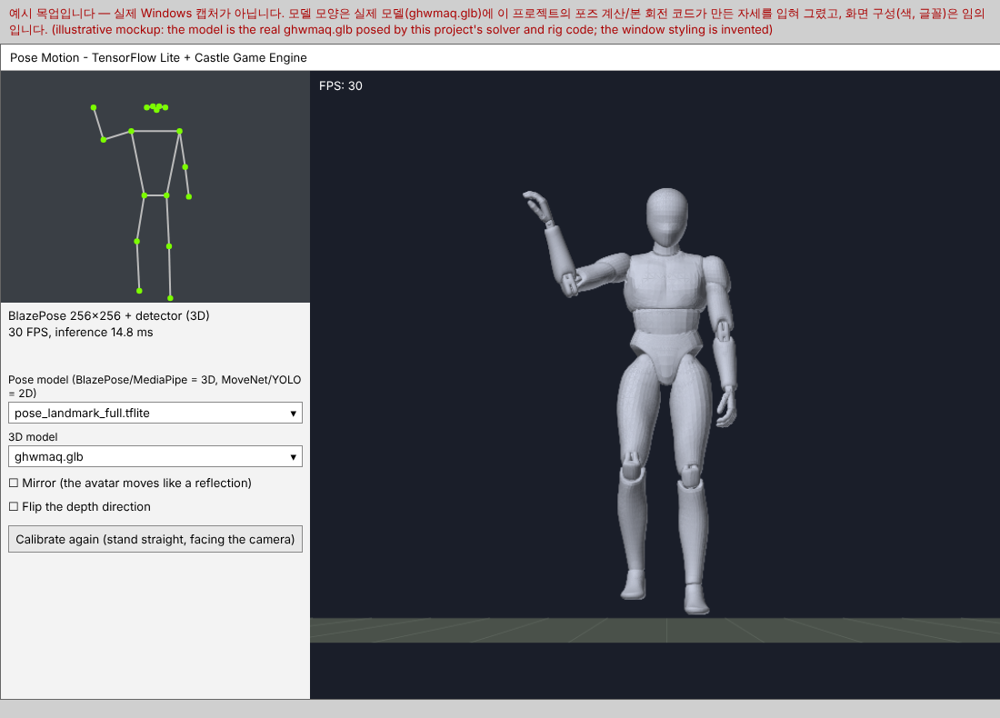

# Pose Motion

[한국어](README.md)

A Delphi application that measures the human pose from a webcam in real time
with **TensorFlow Lite** and makes a **rigged 3D human model (glTF)** do the same
movements. The 3D rendering uses
[Castle Game Engine](https://github.com/hk1207/castle-engine).

* Delphi FMX, Windows, webcam input
* Pose model : **BlazePose (3D, the MediaPipe pipeline processed directly in Delphi)**, **MoveNet (2D)**, **YOLO pose (2D)**, **MediaPipe (3D, Python bridge)**
* Inference engine : **TensorFlow Lite** (`.tflite`) or **ONNX Runtime** (`.onnx`)
* 3D human model : `ghwmaq.glb`, `GHWBodyModel.glb` (the zip can be used as it is)

```
webcam frame --> pose model (TFLite / ONNX Runtime) --> 17 keypoints (+ 3D positions)
(or Python MediaPipe bridge --UDP--> 33 landmarks + 3D positions)
   --> smoothing + 3D joints (uPoseSolver) --> bone rotations (uPoseRig)
   --> rigged glTF model (uRiggedAvatar)
```



*A mockup, not a real Windows capture. The pose of the 3D model is what the pose solver and the bone rotation code of this project give for `models/ghwmaq.glb`; the window styling (colors, fonts) is invented. It will be replaced by a real screenshot once the application has been run.*

## Folders

| Folder/file | Content |
| --- | --- |
| `src/uInference.pas` | Common interface of the inference engines (TFLite and ONNX Runtime share the model code) |
| `src/uTFLite.pas` | TensorFlow Lite C API binding (`tensorflowlite_c.dll` is loaded at run time) |
| `src/uOnnxRuntime.pas` | ONNX Runtime C API binding (`onnxruntime.dll` is loaded at run time) |
| `src/uPoseEstimator.pas` | Common interface of the pose models |
| `src/uMoveNet.pas` | MoveNet SinglePose (Lightning/Thunder), 2D |
| `src/uBlazePose.pas` | The MediaPipe Pose pipeline, processed directly : detection -> rotated square -> landmarks -> tracking |
| `src/uBlazeDetect.pas`, `src/uBlazeDecode.pas` | Detector model (anchors, decoding), landmark model decoding, rotated square |
| `src/uYoloPose.pas`, `src/uYoloDecode.pas` | YOLOv8/11-pose ONNX models, 2D |
| `src/uMediaPipeBridge.pas`, `src/uMediaPipeProtocol.pas` | Receives the MediaPipe (Python) bridge (UDP) |
| `src/uPoseModels.pas` | Opens a `.tflite`/`.onnx` file and detects the kind of model |
| `tools/mediapipe_bridge.py` | Python program : runs the MediaPipe Pose Landmarker on the webcam and sends it over UDP |
| `src/uPoseImage.pas` | Crops the camera frame and converts it to the model input (RGB) |
| `src/uPoseSolver.pas` | Smoothing, scale, 2D/3D keypoints -> 3D joints of the body |
| `src/uPoseRig.pas` | Joints -> rotations of the model bones. Profile of each model |
| `src/uRiggedAvatar.pas` | Loads the rigged glTF model and applies the bone rotations |
| `app/` | The FMX application (`PoseMotion.dpr`, the form is created in code) |
| `models/` | 3D models (`ghwmaq.glb`, `GHWBodyModel.zip`) and the place for the pose models |
| `tests/` | Tests of the pose solver, the rig, BlazePose decoding and image code (Free Pascal) |

## Pose models

| Model | File | Output | Notes |
| --- | --- | --- | --- |
| **BlazePose** (MediaPipe, direct) | `.tflite` or `.onnx` (+ pose detector model) | 33 landmarks + **3D world coordinates (meters)** | The depth and the turn of the body are **measured**. Delphi only, no bridge. Recommended |
| **MediaPipe bridge** | (Python program) | 33 landmarks + **3D world coordinates** | The official MediaPipe library as it is |
| **MoveNet** (Lightning/Thunder) | `.tflite` or `.onnx` | 17 2D keypoints | Fast and simple. The depth is **estimated** from the bone lengths |
| **YOLO pose** (v8/11) | `.onnx` | 17 2D keypoints | Finds the person first. The depth is **estimated** |

The kind of the model is detected from the shape of its outputs. Put the `.tflite`/`.onnx` file in
`models/`; the application finds it and you can select it in the left panel. See
[models/README.md](models/README.md) to download them. A MediaPipe `.task` file works as it is.

### MediaPipe processed directly (no Python)

The processing of MediaPipe Pose was ported to Delphi. No Python and no bridge are needed.

1. The **pose detector model** (`pose_detection.tflite`, input 224x224) finds the person in the whole
   image and gives the center of the body and a point on the circle that surrounds it (the 2254 SSD
   anchors are generated and decoded here).
2. With these two points a **rotated square** around the body (scaled 1.25) is cropped. The model gets an
   upright person even if the body is leaning or lying.
3. The **landmark model** (`pose_landmark_*.tflite`, input 256x256) gives 33 landmarks and the 3D world
   coordinates. The world coordinates are turned back by the rotation of the square.
4. The square of the next frame comes from the landmarks of this frame (33 and 34) : tracking. When the
   body is lost the detector is used again.

Put the detector file (`pose_detection.tflite` or `pose_detector.tflite`) next to the landmark model and
it is used automatically. A MediaPipe `.task` file has both, so it works as it is. Without a detector only
the square at the center of the image is used, so the person has to stand in the middle.

### ONNX Runtime

An `.onnx` file runs with `onnxruntime.dll` (1.14 or newer). Inputs `[1,H,W,3]` and `[1,3,H,W]` are
supported, with float32 or uint8 values. ONNX versions of BlazePose and MoveNet and YOLOv8/11-pose
models work. Only float32 outputs are supported (no float16 models). See [bin/README.md](bin/README.md)
for the DLL.

### MediaPipe (Python bridge)

MediaPipe is a C++/Python library, so Delphi can't call it directly. A Python program runs the MediaPipe
Pose Landmarker and sends the result to the application over UDP (127.0.0.1:5005).

```
pip install -r tools/requirements.txt
python tools/mediapipe_bridge.py --model pose_landmarker_full.task
```

Then select **MediaPipe (Python bridge ...)** in the pose model list of the application. A webcam can only
be opened by one program : in this mode Python opens the camera and the application doesn't use its own.
There are also `--video file.mp4`, `--image picture.jpg` and `--preview` (a preview window in Python).

Other ways to measure a 3D pose (not in this application yet) :

* 2D -> 3D lifting models : VideoPose3D, MotionBERT (convert to ONNX and write a new `TPoseEstimator`)
* Human mesh recovery : HMR2.0 / 4DHumans, ROMP, WHAM (SMPL model, GPU needed)
* Depth cameras : Azure Kinect Body Tracking, Intel RealSense, ZED (hardware needed)
* To add a model, inherit `TPoseEstimator` (`src/uPoseEstimator.pas`) and implement `Estimate`.

## 3D human models

Both models are rigged (skinned). The application recognizes the model by its bone names.

| File | Bones | Notes |
| --- | --- | --- |
| `models/ghwmaq.glb` | `pelvis`, `spine1/2`, `l.arm1/2`, `l.leg/2/3` ... | Simple human model (6.6 MB) |
| `models/GHWBodyModel.zip` | `Spine001..006`, `Upper Arm L`, `Thigh L` ... | Anatomical model with muscles/organs/nerves (a 45 MB `.glb` in the zip) |

`GHWBodyModel.zip` doesn't have to be unzipped : the application extracts the `.glb` to the
temporary folder the first time.

The bone rotations are calculated from the rest pose of the model, so different bone orientations
work. For another rigged model add a profile (bone names, parents, roles) in `src/uPoseRig.pas`.

## Build and run

1. **Castle Game Engine** : get https://github.com/hk1207/castle-engine and install its Delphi packages
   (`packages/delphi/AllPackages.groupproj`, install all except `castle_engine_window`).
2. Get a pose model and the DLL of its engine : `.tflite` -> **`tensorflowlite_c.dll`**,
   `.onnx` -> **`onnxruntime.dll`** ([models/README.md](models/README.md), [bin/README.md](bin/README.md)).
   No DLL is needed if you only use the MediaPipe bridge.
3. Open `app/PoseMotion.dpr` in Delphi, build for **Windows 64-bit** and run it.
   Put the DLL next to the executable.
4. Stand 2-3 m from the camera, so that the whole body is visible, face the camera and press
   **Calibrate again**.

Command line : `PoseMotion.exe [pose model .tflite/.onnx/.task or udp://127.0.0.1:5005] [3D model .glb/.zip]`

## From pose to 3D

* The keypoints are smoothed with a One Euro filter (low jitter, low lag).
* The scale (meters per pixel) comes from the torso length, so the model has the same size near or
  far from the camera.
* **BlazePose** : the limbs follow the directions of the 3D world positions, the shoulder line gives
  the turn of the body and the nose and ears give the turn of the head.
* **MediaPipe bridge** : uses the 3D world positions like BlazePose.
* **MoveNet / YOLO pose** : the missing length of a bone is the depth. The direction can't be seen, so elbows and
  knees bend to the camera by default. If they move the wrong way, tick **Flip the depth direction**.
* For each bone, the rotation "direction at rest -> measured direction" is applied to the model bone.

## Tests

The parts without Windows dependencies (pose solver, rig, BlazePose decoding, image code) are tested
with Free Pascal :

```
cd tests
fpc -Mdelphi -Fu../src TestPose.pas
./TestPose
```

The TensorFlow Lite / ONNX Runtime bindings, the UDP receiver, the camera, the Castle Game Engine model
loading and the form need Delphi on Windows and were **not compiled or run yet**. The decoding of the pose detector (2254 anchors, rotated square, rotated image crop) is tested with synthetic input, not with the real model files. `tools/mediapipe_bridge.py`
was not run with MediaPipe either : only the format of the line that it sends (`--selftest`) is tested with
the Pascal parser.

## Limits

* Direct BlazePose tracks one person (like `num_poses=1` of MediaPipe) : several people are not supported.
* The direct processing doesn't use the landmark smoothing filters of MediaPipe : the One Euro filter of the application is used. The first frame uses the square at the center of the
  image, so the person has to stand in the middle with the whole body visible. Then the body is tracked.
* Fingers, toes and face expressions don't move (the hand follows the forearm).
* One camera only : hidden parts are not accurate.
